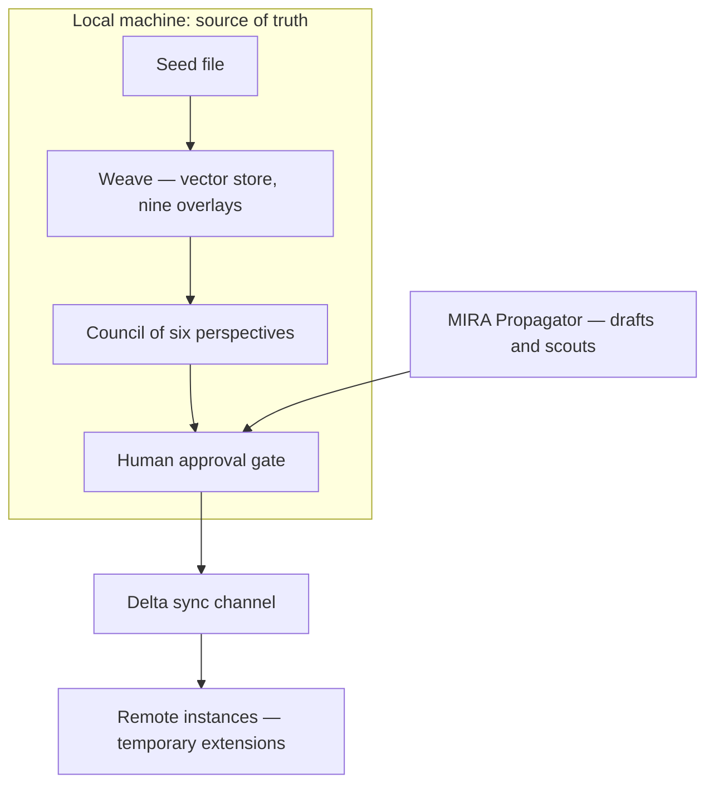
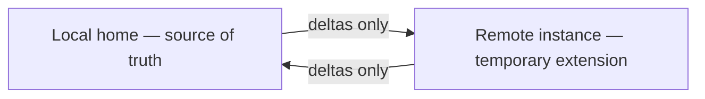

<h1 align="center">MIRA / ACCT</h1>

<p align="center"><em>Agent memory that survives a model swap.</em></p>

<p align="center">
  
  <a href="#status"></a>
  <a href="#local-first"></a>
  <a href="https://github.com/intellimira/mira-acct-protocol/issues"></a>
</p>

---

## Contents

- [Background](#background)
- [What MIRA is](#what-mira-is)
- [Architecture](#architecture)
- [The weave](#the-weave)
- [The seed file](#the-seed-file)
- [Delta sync](#delta-sync)
- [The council and the ethoses](#the-council-and-the-ethoses)
- [Local-first](#local-first)
- [The base layer](#the-base-layer)
- [Runtime options](#runtime-options)
- [Getting started](#getting-started)
- [Worked examples](#worked-examples)
- [Live demonstration](#live-demonstration)
- [Status](#status)
- [Links](#links)

---

## Background

Randolph Vusi Dube is a solutions architect and AI entrepreneur. For nearly twenty years he has worked in payments and data systems, shipping billing platforms, customer-data models and payment migrations that had to pass audit at institutions such as Barclays, Lloyds and WorldPay. The lesson that stayed with him is this: what a system really does lives in the exceptions people remember and nobody writes down.

## What MIRA is

MIRA is a protocol, not a product. Its formal name is ACCT — Artificially Contextual Cognitive Thinking. It is a protocol for shared pattern recognition: a way for a person and their machines to keep the patterns they notice, and to exchange those patterns with other instances, without handing over an entire memory.

The model's weights are interchangeable. Identity lives in files, not in the model underneath.


## Architecture

The diagram below is the intended shape of a MIRA instance. The seed, the weave, delta sync and a packaged reference runtime are still **Planned** as runnable code in this repository. What already exists in day-to-day use is the human approval gate, and MIRA Propagator as a drafting and scouting layer — see [Live demonstration](#live-demonstration).



Outbound drafts from MIRA Propagator pass through the same human approval gate. Nothing leaves the machine without that yes.

## The weave

The core idea is the weave: a vector space with nine overlays. It stores not only what was noticed, but who said it, when, how it felt, and what it was for.

The nine overlays are:

1. Distance
2. Colour
3. Conversational context
4. Source
5. Semantic content
6. Redundancy
7. Recency
8. Emotional valence
9. Intent

How each overlay is encoded, weighted and queried is to be specified. They are meant to sit on one vector space, rather than in separate stores.

The shape below is **illustrative**. It is not a formal schema.

```yaml
# Illustrative only — the on-the-wire schema is to be specified.
id: wv_example_001
noticed: "A payment exception that never made it into the formal spec."
overlays:
  distance: 0.14
  colour: "amber"
  conversational_context: "design review, 2026-11-27"
  source: "operator"
  semantic_content: "exceptions as the true system behaviour"
  redundancy: 0.2
  recency: "2026-11-27"
  emotional_valence: "concern"
  intent: "preserve a pattern that official docs omit"
```

## The seed file

Identity lives in one markdown seed file. That file is the entire identity: portable, encrypted to the person, and loadable into any instance. The formal format of the file, and the encryption scheme, are to be specified.

The skeleton below is **illustrative**. The formal format is to be specified. If you want a local draft, copy it into a file of your own and do not commit a real identity.

```markdown
<!-- Illustrative seed-file skeleton. The formal schema is to be specified. -->

# Seed

This file is the instance's identity. It is portable, encrypted to its
person, and loadable into any MIRA instance.

## Ethoses

[SIX_ETHOSES]

## Council

- First Principles
- Scientific Method
- Philosophical Inquiry
- Creative Synthesis
- Pragmatic Application
- The Dark Passenger — a hostile reviewer

## Notes

…
```

## Delta sync

Instances do not ship the whole seed file, or the whole weave, to one another. Only changes travel. The local home is the source of truth; remote instances are temporary extensions of it.



Conflict handling, authentication of a delta, and the exact delta format are to be specified.

## The council and the ethoses

Thinking is run through a council of six perspectives. In the private reference implementation those six are named:

1. First Principles
2. Scientific Method
3. Philosophical Inquiry
4. Creative Synthesis
5. Pragmatic Application
6. The Dark Passenger — a hostile reviewer

The work is held to six ethoses: [SIX_ETHOSES].

## Local-first

MIRA is built to run locally: on a 16 GB laptop, with no GPU, using local models. A human approves anything that leaves the machine.

## The base layer

MIRA is a malleable operating layer. It is meant to sit on top of an ordinary developer environment and an agentic runtime, not to replace them.

The author's reference environment is [Omarchy](https://omarchy.org/), an opinionated Arch Linux setup by David Heinemeier Hansson, built around the Hyprland tiling compositor. Omarchy describes itself as a malleable, agent-friendly Linux system. Together with agentic runtimes such as OpenCode, it provides the base execution: a machine, a terminal, local models, and a place for an agent to work.

MIRA adds what the base layer does not: the weave, seed-file identity, the council of perspectives, the human approval gate, and delta sync. The stack is intended to stay portable across local models (for example Ollama) and cloud models.

MIRA is not Omarchy-specific. You do not need Omarchy to read this protocol or to follow [Getting started](#getting-started). Omarchy is the author's reference environment, not a requirement. Any packaged integration between MIRA and Omarchy is **Planned**; this repository does not include Omarchy-specific install or integration commands.

## Runtime options

The protocol loop is the same wherever it runs: load the seed file as context, run the council of perspectives, stop at the human approval gate, and keep a log. The options below are hosts for that loop. A dedicated MIRA command that performs the whole loop on any of them is **Planned**.

### Grok CLI

**What it gives you.** The official [Grok CLI](https://docs.x.ai/build/overview) (also called Grok Build) is xAI's terminal coding agent. It runs as an interactive TUI, or headlessly for a single prompt.

**What it needs.** A terminal, and a Grok sign-in or an xAI API key. Install, as documented by xAI:

```bash
curl -fsSL https://x.ai/cli/install.sh | bash
```

```powershell
irm https://x.ai/cli/install.ps1 | iex
```

Or `npm i -g @xai-official/grok`. Then, in a project folder, `grok`.

**Limitation.** `grok` is a general coding agent. There is no verified Grok subcommand that runs the MIRA protocol loop. Until that is wired, treat it as a host: load the seed as context, ask for a council pass, and keep the approval gate in human hands. That adaptation is **Planned**.

### Herdr

**What it gives you.** [Herdr](https://herdr.dev/) (the name is sometimes heard as “Herder”) is an agentic terminal runtime: agents keep running after you close a window, can start and steer other agents, and can be attached to later. Omarchy lists it among available tools. It can host a MIRA loop the same way it hosts other terminal agents.

**What it needs.** A machine that can run `hc`, Herdr's core CLI. Herdr documents this install for its core:

```bash
curl -fsSL https://releases.herdr.dev/core/install.sh | sh
```

**Limitation.** There is no verified MIRA-specific Herdr command or template. Using Herdr as a host for the protocol loop is an adaptation, and is **Planned**.

### Generic command line

**What it gives you.** A standalone terminal process with no GUI: OpenCode, plus local models, on the machine you already set up.

**What it needs.** The dependencies in [Getting started](#getting-started). After the private reference repository is available and OpenCode is on your `PATH`, the documented launch is:

```bash
opencode
```

**Limitation.** This public repository has no `mira` binary and no one-shot “run the protocol loop” command. The OpenCode launch above is a real command once OpenCode itself is installed. Loading a seed, running the council, and enforcing the approval gate inside that session are **Planned**. Docker is not required for this path.

## Getting started

This repository is a specification. It contains no runnable MIRA runtime. The steps below are marked **Available now** or **Planned** so it is clear what you can do today.

### 1. Cloning

**Available now.** You need Git. Clone this public repository:

```bash
git clone https://github.com/intellimira/mira-acct.git
cd mira-acct
```

**Optional, invite-only.** A private reference implementation exists at `intellimira/mira-oj`. It is not public. If the author has given you access:

```bash
git clone https://github.com/intellimira/mira-oj.git
```

Without an invite, that clone will fail, and you should stay with this public repository.

### 2. Dependencies

**Available now**, when you have access to the private reference repository. That repository's Windows bootstrap (`setup.ps1`) expects:

- Python 3.11 or newer
- [Ollama](https://ollama.com), as the local model runtime
- [OpenCode](https://opencode.ai), as the agentic runtime (the bootstrap deploys an OpenCode config; on Linux and macOS the documented helper is `python3 scripts/setup_opencode_env.py`, which deploys that config and adjusts `PATH`)
- Python packages from its `requirements.txt` (installed into a virtual environment by `setup.ps1`)
- NEXUS memory, bootstrapped by `setup.ps1` unless you pass `-Quick`

Docker is **not** installed or required by that bootstrap. Treat it as optional for other tools on your machine, not as a MIRA prerequisite.

The models `setup.ps1` actually pulls, which are a reasonable fit for a 16 GB laptop with no GPU, are:

```bash
ollama pull qwen3:8b
ollama pull qwen2.5-coder:7b
ollama pull nomic-embed-text
```

Those `ollama pull` commands are optional here, and only useful if you are running local models yourself.

On Windows, from inside the private reference repository, the documented commands are:

```powershell
.\setup.ps1
# or, skipping the NEXUS bootstrap:
.\setup.ps1 -Quick
```

On Linux and macOS, the documented OpenCode helper (not a full equivalent of `setup.ps1`) is:

```bash
python3 scripts/setup_opencode_env.py
```

There is no documented one-shot Linux installer in that repository that also creates the virtual environment, installs Python dependencies, pulls the models, and bootstraps NEXUS. Those remaining steps would need to be done by hand, and only if you have access to the private repository.

**Planned** in this public repository: a reference runtime that you can stand up without a private invite.

### 3. The three pillars

**Planned.** A dedicated “three pillars” setup procedure was not found in the reference implementation's documented bootstrap. Do not expect a command in this repository that configures them.

### 4. The six personas

**Available now** as names and as an illustrative seed template; **Planned** as a packaged runtime configuration in this public repository.

The private reference implementation defines a six-persona council (First Principles, Scientific Method, Philosophical Inquiry, Creative Synthesis, Pragmatic Application, and the Dark Passenger). Its OpenCode setup is described as deploying four agent tabs — workflow, autoresearch, plan, and build — which are a runtime layout, not the council itself.

Copy the illustrative skeleton in [The seed file](#the-seed-file) into a local file if you want a draft (this does not start a runtime). Do not commit a real identity. The six ethoses remain [SIX_ETHOSES] until they are published.

### 5. Initialising the weave

**Planned.** The nine overlays are specified in this document. The private reference implementation, as reviewed for this guide, does not include a documented command that initialises a weave store with those nine overlays. There is nothing to run for this step in the public repository.

### 6. Connecting MIRA Propagator

**Planned / manual.** MIRA Propagator is a hosted assistant, not a package in this repository. Today it can draft and scout from the public protocol, and every outbound post still stops at the human approval gate. There is no install command, identifier, or config file to wire it into a local instance. When that wiring exists, it will be documented here.

## Worked examples

In minutes you can clone this repository, read the protocol, and start a drafting conversation with an assistant like MIRA Propagator. A full local conversation with MIRA itself follows the Getting Started steps as they ship.

### On a phone

Open [this repository](https://github.com/intellimira/mira-acct-protocol) in a browser and read the protocol in this README. If you already use an assistant such as MIRA Propagator, you can begin a drafting conversation there — for example, asking it to draft a short post from one of the protocol's ideas, which still will not be published without your explicit yes.

No further setup is needed to read the protocol or to start that drafting conversation. A full local MIRA conversation is not a phone-install away; it follows the Getting Started steps as they ship, including those still marked Planned (the private reference runtime, the weave, and delta sync).

### On a desktop

Clone the public repository and read the same documents:

```bash
git clone https://github.com/intellimira/mira-acct.git
cd mira-acct
```

Optionally copy the illustrative seed skeleton from [The seed file](#the-seed-file) into a local file if you want something to edit. Then start a drafting conversation with an assistant like MIRA Propagator, holding anything outbound for your approval.

No further setup is needed, beyond the Available steps in Getting Started, to read the protocol and start that drafting conversation. A full local MIRA conversation still depends on the Planned steps in Getting Started (the private reference runtime, the weave, and delta sync).

## Live demonstration

Alongside this specification, a working assistant agent called MIRA Propagator already runs a MIRA-shaped workflow day to day. It was built as a Grok Bot, and set up during a Grok voice session.

What it does today:

- Drafts social copy on rotating narrative angles, carrying earlier narratives forward instead of repeating them.
- Scouts and ranks channels for that work.
- Checks infrastructure, including Docker on the author's machine and access to this repository.
- Holds every outbound post for explicit human approval. Nothing is published without that yes.
- Logs every action with timestamps.

This is evidence that parts of the protocol's operating shape — a human-in-the-loop approval boundary, context that is carried forward, and an auditable log — are practical today. The seed file, the weave and delta sync are next to be wired in; this agent does not yet implement them.

## Status

This is early work. The present repository is a specification in progress. There are no benchmarks yet. Released under the [MIT Licence](LICENSE). Feedback and critique are welcome in [Issues](https://github.com/intellimira/mira-acct-protocol/issues).

## Links

- This repository: [https://github.com/intellimira/mira-acct](https://github.com/intellimira/mira-acct-protocol)
- IntelliGrowth: [https://linkedin.com/company/intelligrowthai](https://linkedin.com/company/intelligrowthai)
