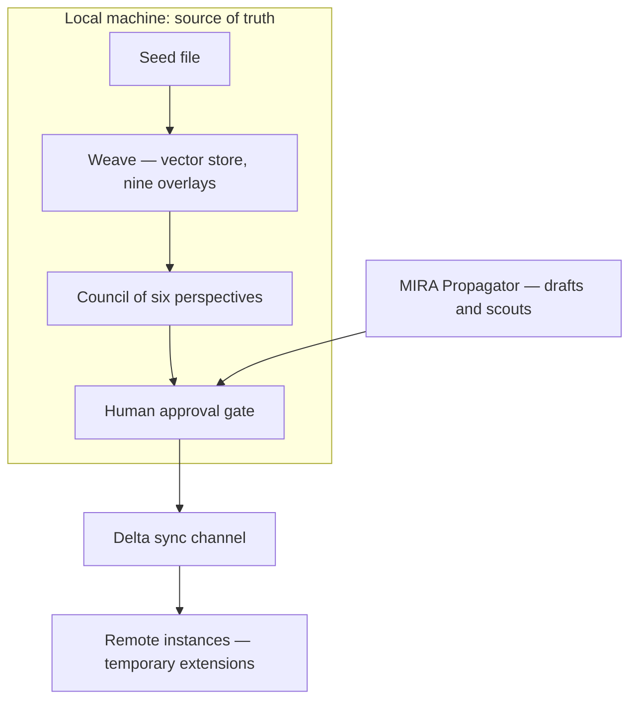
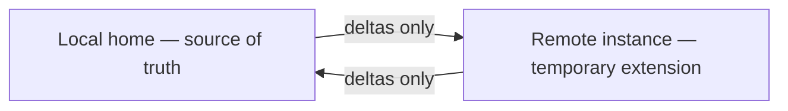

<h1 align="center">MIRA / ACCT</h1>

<p align="center"><em>Agent memory that survives a model swap.</em></p>

<p align="center">
  
  <a href="#status"></a>
  <a href="#local-first"></a>
  <a href="https://github.com/intellimira/mira-acct-protocol/issues"></a>
</p>


---

MIRA is a protocol, not a product. Its formal name is ACCT — Artificially Contextual Cognitive Thinking. It is a way for a person and their machines to keep the patterns they notice, and to exchange those patterns with other instances, without handing over an entire memory. It is for people who want that memory in files, on a [local machine](#local-first), with a [human yes](#local-first) before anything leaves. This repository is an early specification, and it contains no runnable MIRA runtime.

## Contents

- [At a glance](#at-a-glance)
- [Quick start](#quick-start)
- [Background](#background)
- [What MIRA is](#what-mira-is)
- [Architecture](#architecture)
- [The weave](#the-weave)
- [The seed file](#the-seed-file)
- [Delta sync](#delta-sync)
- [The council and the ethoses](#the-council-and-the-ethoses)
- [Local-first](#local-first)
- [The base layer](#the-base-layer)
- [Runtime options](#runtime-options)
- [Getting started](#getting-started)
- [Worked examples](#worked-examples)
- [Live demonstration](#live-demonstration)
- [Status](#status)
- [Links](#links)

---

## At a glance

Nothing marked **Planned** is runnable in this repository today.

| Component | Status |
| --- | --- |
| Seed file | **Planned**. Format and encryption: [The seed file](#the-seed-file). |
| Weave | **Planned**. Overlays and encoding: [The weave](#the-weave). |
| Council | **Available now** as names and as an illustrative seed template; **Planned** as a packaged runtime configuration. |
| Human approval gate | Already in day-to-day use. See [Local-first](#local-first). |
| Delta sync | **Planned**. Conflict handling and format: [Delta sync](#delta-sync). |
| Reference runtime | **Planned** (including a dedicated loop command). Private `intellimira/mira-oj` is **Optional, invite-only**; see [1. Cloning](#1-cloning). |
| MIRA Propagator | Drafting and scouting already in day-to-day use; local wiring is **Planned**. See [Live demonstration](#live-demonstration). |

## Quick start

In minutes you can clone this repository, read the protocol, and start a drafting conversation with MIRA Propagator. Phone and desktop paths are in [Worked examples](#worked-examples). A full local conversation with MIRA itself follows [Getting started](#getting-started) as those steps ship, including ones still marked **Planned** (the private reference runtime, the weave, and delta sync).

## Background

Randolph Vusi Dube is a solutions architect and AI entrepreneur. He has nearly twenty years in payments and data systems — billing platforms, customer-data models and payment migrations that had to pass regulated-industry audit. Building MIRA draws on that depth and on hands-on experience in agent architectures, local AI runtimes and human-in-the-loop control design. The lesson that stayed with him: what a system really does lives in the exceptions people remember and nobody writes down.

## What MIRA is

The model's weights are interchangeable. Identity lives in files, not in the model underneath.

## Architecture

The diagram is the intended shape of a MIRA instance. Status for each part is in [At a glance](#at-a-glance). Outbound drafts from [MIRA Propagator](#live-demonstration) pass through the [human approval gate](#local-first).



## The weave

The weave is a vector space with nine overlays. It stores not only what people noticed, but who said it, when, how it felt, and what it was for.

| 1. Distance | 2. Colour | 3. Conversational context |
| --- | --- | --- |
| 4. Source | 5. Semantic content | 6. Redundancy |
| 7. Recency | 8. Emotional valence | 9. Intent |

How each overlay is encoded, weighted and queried is to be specified. The overlays sit on one vector space, rather than in separate stores.

The shape below is **illustrative**, not a formal schema.

```yaml
# Illustrative only — the on-the-wire schema is to be specified.
id: wv_example_001
noticed: "A payment exception that never made it into the formal spec."
overlays:
  distance: 0.14
  colour: "amber"
  conversational_context: "design review, 2026-11-27"
  source: "operator"
  semantic_content: "exceptions as the true system behaviour"
  redundancy: 0.2
  recency: "2026-11-27"
  emotional_valence: "concern"
  intent: "preserve a pattern that official docs omit"
```

## The seed file

One markdown seed file is the entire identity: portable, encrypted to the person, and loadable into any instance. The formal format and encryption scheme are to be specified.

The skeleton below is **illustrative**. For a local draft, copy it into a file of your own and do not commit a real identity.

```markdown
<!-- Illustrative seed-file skeleton. The formal schema is to be specified. -->

# Seed

This file is the instance's identity. It is portable, encrypted to its
person, and loadable into any MIRA instance.

## Council

- First Principles
- Scientific Method
- Philosophical Inquiry
- Creative Synthesis
- Pragmatic Application
- The Dark Passenger — a hostile reviewer
```

## Delta sync

Instances do not ship the whole seed file, or the whole weave, to one another. Only changes travel. The local home is the source of truth. Remote instances are temporary extensions of it.



Conflict handling, authentication of a delta, and the exact delta format are to be specified.

## The council and the ethoses

Thinking goes through a council of six perspectives. In the private reference implementation those six are named First Principles, Scientific Method, Philosophical Inquiry, Creative Synthesis, Pragmatic Application, and the Dark Passenger — a hostile reviewer.

The work follows six ethoses; their publication is **Planned**.

## Local-first

MIRA runs locally: on a 16 GB laptop, with no GPU, using local models. A human approves anything that leaves the machine.

## The base layer

MIRA is a malleable operating layer. It sits on top of an ordinary developer environment and an agentic runtime, not in place of them.

The author's reference environment is [Omarchy](https://omarchy.org/), an opinionated Arch Linux setup by David Heinemeier Hansson around the Hyprland tiling compositor. It describes itself as a malleable, agent-friendly Linux system. With agentic runtimes such as OpenCode, it provides the base execution: a machine, a terminal, local models, and a place for an agent to work. Omarchy is a reference, not a requirement; MIRA is not Omarchy-specific, and you do not need it to read this protocol or to follow [Getting started](#getting-started). Any packaged MIRA–Omarchy integration is **Planned**. This repository has no Omarchy-specific install or integration commands.

MIRA adds what the base layer does not: the weave, seed-file identity, the council of perspectives, the human approval gate, and delta sync. The stack should stay portable across local models (for example Ollama) and cloud models.

## Runtime options

The protocol loop is the same on every host: load the seed file as context, run the council of perspectives, stop at the [human approval gate](#local-first), and keep a log. A dedicated MIRA command that performs that loop is **Planned**.

| Option | Gives you | Needs | Limitation |
| --- | --- | --- | --- |
| [Grok CLI](https://docs.x.ai/build/overview) (also called Grok Build) | xAI's terminal coding agent; an interactive TUI, or headless for a single prompt | A terminal, plus a Grok sign-in or xAI API key; install as documented by xAI (below) or `npm i -g @xai-official/grok`, then `grok` in a project folder. | `grok` is a general coding agent, with no verified subcommand that runs the MIRA protocol loop. Until that is wired, treat it as a host for the loop above, and keep the approval gate in human hands. That adaptation is **Planned**. |
| [Herdr](https://herdr.dev/) (sometimes heard as “Herder”) | An agentic terminal runtime: agents keep running after you close a window, can start and steer other agents, and can be attached to later. Omarchy lists it among available tools, and it can host a MIRA loop as it hosts other terminal agents. | A machine that can run `hc`, Herdr's core CLI. | There is no verified MIRA-specific Herdr command or template. That host adaptation is **Planned**. |
| Generic command line | A standalone terminal process with no GUI: OpenCode, plus local models, on the machine you already set up | The dependencies in [Getting started](#getting-started). After the private reference repository is available and OpenCode is on your `PATH`, the documented launch is `opencode`. | This public repository has no `mira` binary and no one-shot “run the protocol loop” command. Once OpenCode is installed, `opencode` is a real command. Loading a seed, running the council, and enforcing the approval gate in that session are **Planned**. Docker is not required for this path. |

### Grok CLI

Install, as documented by xAI:

```bash
curl -fsSL https://x.ai/cli/install.sh | bash
```

```powershell
irm https://x.ai/cli/install.ps1 | iex
```

### Herdr

Herdr documents this install for its core:

```bash
curl -fsSL https://releases.herdr.dev/core/install.sh | sh
```

### Generic command line

```bash
opencode
```

## Getting started

| Step | Status |
| --- | --- |
| [1. Cloning](#1-cloning) | **Available now** (public repository). **Optional, invite-only** (`intellimira/mira-oj`). |
| [2. Dependencies](#2-dependencies) | **Available now** with private-repo access. A public runtime without an invite is **Planned**. |
| [3. The three pillars](#3-the-three-pillars) | **Planned**. |
| [4. The six personas](#4-the-six-personas) | **Available now** (names, seed template); **Planned** (packaged configuration). |
| [5. Initialising the weave](#5-initialising-the-weave) | **Planned**. |
| [6. Connecting MIRA Propagator](#6-connecting-mira-propagator) | **Planned**. |

### 1. Cloning

**Available now.** You need Git. Clone this public repository:

```bash
git clone https://github.com/intellimira/mira-acct-protocol.git
cd mira-acct-protocol
```

**Optional, invite-only.** A private reference implementation exists at `intellimira/mira-oj`. It is not public. If the author has given you access:

```bash
git clone https://github.com/intellimira/mira-oj.git
```

Without an invite, that clone will fail, and you should stay with this public repository.

### 2. Dependencies

For access to `intellimira/mira-oj`, see [1. Cloning](#1-cloning).

<details>
<summary>Private-repository dependencies and Windows, Linux and macOS setup</summary>

That repository's Windows bootstrap (`setup.ps1`) expects:

- Python 3.11 or newer
- [Ollama](https://ollama.com), as the local model runtime
- [OpenCode](https://opencode.ai), as the agentic runtime (the bootstrap deploys an OpenCode config; on Linux and macOS the documented helper is `python3 scripts/setup_opencode_env.py`, which deploys that config and adjusts `PATH`)
- Python packages from its `requirements.txt` (installed into a virtual environment by `setup.ps1`)
- NEXUS memory, bootstrapped by `setup.ps1` unless you pass `-Quick`

Docker is **not** installed or required by that bootstrap. It is optional for other tools, not a MIRA prerequisite.

Models `setup.ps1` actually pulls, a reasonable fit for the [local-first](#local-first) 16 GB, no-GPU target:

```bash
ollama pull qwen3:8b
ollama pull qwen2.5-coder:7b
ollama pull nomic-embed-text
```

Those `ollama pull` commands are optional here, and only useful if you run local models yourself.

Documented Windows commands, from the private reference repository:

```powershell
.\setup.ps1
# or, skipping the NEXUS bootstrap:
.\setup.ps1 -Quick
```

On Linux and macOS, the documented OpenCode helper (not a full equivalent of `setup.ps1`) is:

```bash
python3 scripts/setup_opencode_env.py
```

That repository has no documented one-shot Linux installer that also creates the virtual environment, installs Python dependencies, pulls the models, and bootstraps NEXUS. Do those remaining steps by hand, and only with the access in [1. Cloning](#1-cloning).

</details>

### 3. The three pillars

MIRA rests on three pillars: [the council of perspectives](#the-council-and-the-ethoses), [the six ethoses](#the-council-and-the-ethoses) and [the weave](#the-weave). Reading them needs nothing beyond this README.

**Planned:** a setup command that configures them. None exists today.

### 4. The six personas

The private reference implementation defines the six-persona council [named above](#the-council-and-the-ethoses). Its OpenCode setup is described as deploying four agent tabs — workflow, autoresearch, plan, and build — which are a runtime layout, not the council itself.

To draft a seed file, copy the skeleton in [The seed file](#the-seed-file). That does not start a runtime.

### 5. Initialising the weave

**Planned.** The private reference implementation, as reviewed for this guide, does not include a documented command that initialises a weave store with the [nine overlays](#the-weave). There is nothing to run for this step in the public repository.

### 6. Connecting MIRA Propagator

**Planned.** MIRA Propagator is a hosted assistant, not a package in this repository. There is no install command, identifier, or config file to wire it into a local instance; when that wiring exists, this README will document it. Today it can draft and scout from the public protocol; see [Live demonstration](#live-demonstration).

## Worked examples

### On a phone

Open [this repository](https://github.com/intellimira/mira-acct-protocol) in a browser and read this README. If you already use MIRA Propagator, begin a drafting conversation there, and hold every outbound post for your explicit yes ([Local-first](#local-first)).

```text
Draft a 150-word post for r/LocalLLaMA explaining the weave's nine overlays. Hold it for my approval.
```

```text
Summarise what MIRA's delta sync does in two sentences for a non-technical reader.
```

You need no further setup to read the protocol or start that drafting conversation. A full local MIRA conversation is not a phone-install away; see [Quick start](#quick-start).

### On a desktop

Clone the public repository and read the same documents:

```bash
git clone https://github.com/intellimira/mira-acct-protocol.git
cd mira-acct-protocol
```

Optionally copy the [seed skeleton](#the-seed-file) into a local file to edit. Then start a drafting conversation with MIRA Propagator, holding anything outbound for your approval.

```text
Read the README in this repository and list the three claims a sceptical Hacker News reader would challenge first.
```

```text
Turn the seed-file section into a short thread, and hold it for my approval.
```

You need no further setup beyond the Available steps in [Getting started](#getting-started). A full local MIRA conversation still depends on the Planned steps there; see [Quick start](#quick-start).

## Live demonstration

MIRA Propagator is a working assistant that already runs a MIRA-shaped workflow day to day. It is a Grok Bot, set up during a Grok voice session.

What it does today:

- Drafts social copy on rotating narrative angles, carrying earlier narratives forward instead of repeating them.
- Scouts and ranks channels for that work.
- Checks infrastructure, including Docker on the author's machine and access to this repository.
- Holds every outbound post for explicit human approval, and publishes nothing without that yes.
- Logs every action with timestamps.

Those practices — a human-in-the-loop approval boundary, context carried forward, and an auditable log — are in use today. This agent does not yet implement the seed file, the weave and delta sync.

## Status

This is early work, a specification in progress. There are no benchmarks yet. Released under the [MIT Licence](LICENSE). Feedback and critique are welcome in [Issues](https://github.com/intellimira/mira-acct-protocol/issues).

## Links

- This repository: [https://github.com/intellimira/mira-acct-protocol](https://github.com/intellimira/mira-acct-protocol)
- IntelliGrowth: [https://linkedin.com/company/intelligrowthai](https://linkedin.com/company/intelligrowthai)
